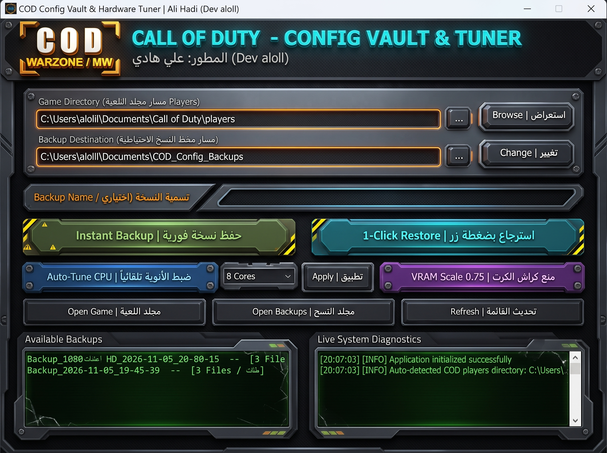

# COD Config Vault & Precision Hardware Tuner (v4.0 Pro)
**أداة خفيفة واحترافية لحفظ واسترجاع إعدادات Call of Duty مع ضبط تلقائي لأداء المعالج وذاكرة كرت الشاشة | تطوير: Ali Hadi (Dev aloll)**

---

## 📸 واجهة البرنامج التكتيكية / Tactical HUD UI Preview

---

## 📖 نبذة عن المشروع / Overview

**COD Config Vault & Precision Hardware Tuner** هي أداة متقدمة مصممة خصيصاً للاعبي **Call of Duty** (Warzone / Modern Warfare / Black Ops 6)، تم تطويرها وهندستها بواسطة **علي هادي (Ali Hadi - Dev aloll)** لحل أكثر المشاكل المزعجة التي تواجه مجتمع اللاعبين بعد كل تحديث للعبة:
- فقدان الإعدادات والحساسية وأزرار التحكم فجأة.
- هبوط الإطارات والتأتأة العنيفة (**Micro-Stuttering**) الناتجة عن سوء توزيع أنوية المعالج.
- انهيار اللعبة المفاجئ (Game Crash) بسبب فرط استهلاك ذاكرة كرت الشاشة (**VRAM Overflow**).

تتميز الأداة بواجهة تكتيكية عسكرية (**Military HUD**) متجاوبة وخفيفة جداً، تدعم اللغتين العربية والإنجليزية، وتعمل مباشرة دون أي تبعات أو إعلانات، مع محرك ذكي يفحص عتاد جهازك ويعدل ملفات إعدادات اللعبة (`.cst`) تلقائياً لتحقيق أعلى معدل فريمات وأقصى استقرار ممكن.

**COD Config Vault & Precision Hardware Tuner** is a dedicated utility engineered by **Ali Hadi (Dev aloll)** for competitive Call of Duty players across Warzone, MW, and Black Ops. It eliminates post-update configuration loss, micro-stutters, and VRAM memory leak crashes through 1-click cloud-like vaulting and precision CPU/GPU engine tuning.

---

## ✨ أبرز المميزات والوظائف / Key Features

### 🛡️ 1. الخزنة والحفظ الفوري (1-Click Vault & Instant Restore)
- **الكشف التلقائي لمسار اللعبة (Auto-Detection)**: قراءة فورية لمجلد إعدادات اللعبة (`Documents\Call of Duty\players`) دون الحاجة للبحث يدوياً.
- **حفظ فوري بضغطة زر (Instant Backup)**: حفظ كافة الإعدادات الرسومية، حساسية الماوس، تخصيص الأزرار، وإعدادات الصوت.
- **استرجاع بنقرة واحدة (1-Click Restore)**: استعادة نسختك الاحتياطية المفضلة فورياً عند حدوث أي خلل بعد تحديثات اللعبة.
- **تسمية النسخ المخصصة (Custom Tag)**: إمكانية تسمية كل نسخة باسم مخصص (مثل: `Best_FPS`, `Ranked_Setup`, `Pre_Update`) لسهولة التمييز.

### ⚡ 2. ضبط الأنوية والمعالج (Auto-Tune CPU Worker Count)
- **كشف معماريات Intel الحديثة**: حساب أنوية الأداء الحقيقية (**P-Cores**) بدقة وتفادي إشغال أنوية الكفاءة (**E-Cores**) لمنع الدروب فريم.
- **تحسين معالجات AMD Ryzen**: ضبط عدد الأنوية الفعالة المخصصة لمحرك الريندر بما يطابق الأنوية الفعلية للمعالج لضمان أقصى ثبات للإطارات.
- **تحديد يدوي مرن (Manual Core Selector)**: قائمة منسدلة تمكنك من اختيار واختبار عدد الأنوية المخصصة (`4`, `6`, `8`, `12` Cores...) وتطبيقها مباشرة.

### 🎮 3. منع كراش كرت الشاشة (VRAM Scale 0.75 Optimizer)
- ضبط قيمة `VideoMemoryScale` في ملفات محرك اللعبة على النسبة الذهبية المستقرة (`0.75`).
- حماية كرت الشاشة من استهلاك الذاكرة الزائد عن الحد، مما يقضي على كراشات الـ Direct-X والانهيار لسطح المكتب أثناء الفايتات العنيفة.

### 📊 4. تشخيص النظام الحي وأزرار التنقل السريع (HUD & Diagnostics)
- **Live System Diagnostics**: شاشة تفاعلية مدمجة تعرض سجل العمليات وحالة فحص المجلدات بدقة.
- **مجلد اللعبة (Open Game)**: اختصار مباشر لفتح مجلد ملفات اللعبة.
- **مجلد النسخ (Open Backups)**: فتح مجلد الأرشيفات والنسخ المحفوظة على جهازك.
- **تحديث القائمة (Refresh)**: إعادة فحص النسخ وتحديث البيانات لحظياً.

---

## 💻 متطلبات النظام والألعاب المدعومة / Requirements & Supported Games

### 🕹️ الألعاب المدعومة:
- Call of Duty: Warzone
- Call of Duty: Modern Warfare (MWI / MWII / MWIII)
- Call of Duty: Black Ops 6

### 🖥️ متطلبات التشغيل:
- **نظام التشغيل / OS**: Windows 10 أو Windows 11 (64-bit).
- **المعالجات المدعومة**: كافة أجيال Intel Core و AMD Ryzen.
- **الصلاحيات**: يعمل بصلاحيات المستخدم العادية (أو كمسؤول لضمان صلاحيات قراءة مجلد المستندات).

---

## 🚀 طريقة الاستخدام / Quick Start

1. حمّل الملف التنفيذي `COD_Vault.exe` من قسم [Releases](../../releases) أو من هذا المستودع.
2. شغّل الأداة بالنقر المزدوج على `COD_Vault.exe`.
3. سيتعرف البرنامج تلقائياً على مسار مجلد اللعبة (`players`).
4. اضغط على **حفظ نسخة فورية | Instant Backup** لتأمين إعداداتك الحالية.
5. اضغط على **ضبط الأنوية تلقائياً | Auto-Tune CPU** و **منع كراش الكرت | VRAM Scale 0.75**.
6. شغّل لعبتك واستمتع بأعلى استقرار وأفضل فريمات!

---

## 👨‍💻 المطور والإشراف / Developer & Credits

- **تطوير وهندسة / Engineered & Developed by**: **علي هادي - Ali Hadi (`Dev aloll`)**
- **البريد الإلكتروني / Email**: `aloll@live.com`
- **حساب GitHub**: [@binhadi](https://github.com/binhadi)

---

## 📄 الترخيص / License

هذا البرنامج متاح للاستخدام الشخصي بموجب رخصة [MIT License](LICENSE).
